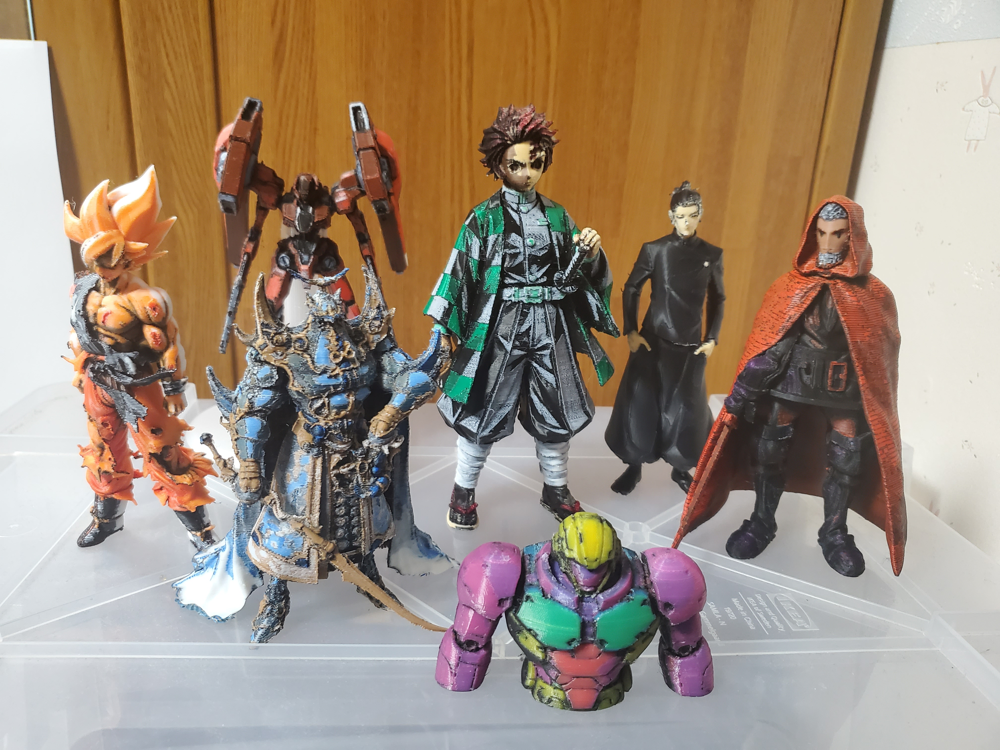
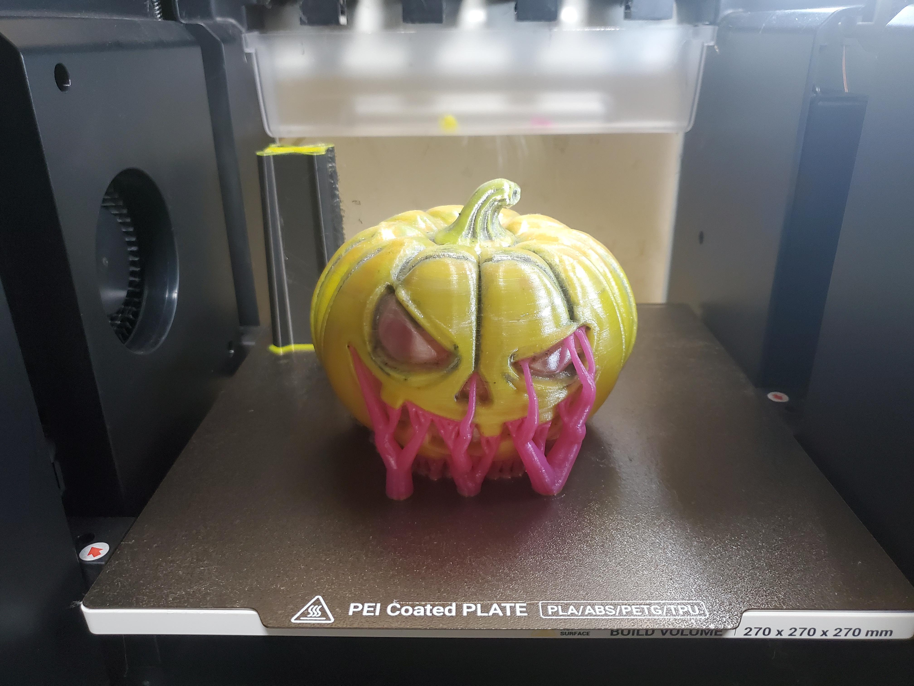
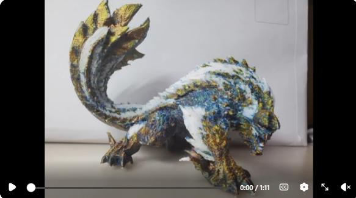
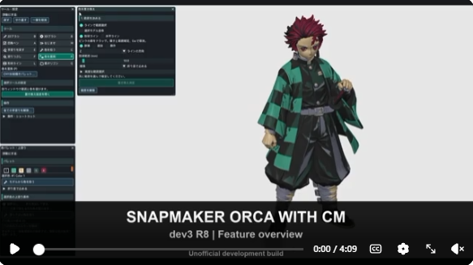
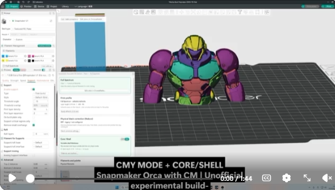
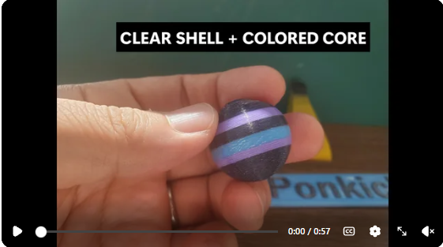

# ChromaMatter · Sorca CM

**色付きモデルを、実際のプリントへ。配色・色編集・混色・スライスをSnapmaker Orcaの中で。**

[English](README.md) · **[ダウンロード](https://chromamatter.app/download)** · **[マニュアル](docs/sonca-cm/README.md)** · [公式サイト](https://chromamatter.app/) · [作例・動画](#作例動画)

ChromaMatterは、色処理の単体アプリとして始まり、その機能をSnapmaker Orcaへ統合した **Orca with CM** に発展しました。今回、ベースがSnapmaker Orca＝「Sorca」であることを伝えるため、統合版の呼び名を **Sorca CM** に変更しました。プロジェクト名はChromaMatterのまま、Snapmaker Orca 2.4.0を基にした非公式の開発版として進めています。

## ダウンロード — v1.0

| Windows | macOS | Linux |
| --- | --- | --- |
| **[ZIPをダウンロード](https://github.com/Ponkichi0718/ChromaMatter/releases/download/sorca-cm-r2-20261022/Sorca-CM-20261022-r2-Windows-x64.zip)** | **[アプリZIPをダウンロード](https://github.com/Ponkichi0718/ChromaMatter/releases/download/sorca-cm-r2-20261022/Sorca-CM-20261022-r2-macos-arm64-app.zip)** | **[tar.gzをダウンロード](https://github.com/Ponkichi0718/ChromaMatter/releases/download/sorca-cm-r2-20261022/Sorca-CM-20261022-r2-Linux-x86_64.tar.gz)** |
| Windows x64 | Apple Silicon・macOS 15以降 | Ubuntu 22.04・x86_64 |
| `Open-Sorca-CM.cmd` | `Sorca CM.app` | `Start-Sorca-CM.sh` |

[更新内容・チェックサム](https://github.com/Ponkichi0718/ChromaMatter/releases/tag/sorca-cm-r2-20261022) · [対応ソース](#対応ソース) · [過去版](https://chromamatter.app/download#previous-versions)

アーカイブ全体を新しいフォルダへ展開してください。**Mac版はad-hoc署名のみで、Apple公証はありません。Intel Macは非対応です。** Linuxにはリリースノート記載の依存ライブラリが必要です。開発版のため、原本を残し、印刷前にスライス結果を確認してください。

## 作例・動画

画像をクリックすると、Redditの投稿・動画・実験の説明を開けます。

<table>
  <tr>
    <td width="33%" valign="top" align="center"> <strong>カラー印刷の作例</strong> Full SpectrumとCore/Shellの試み。 <a href="https://www.reddit.com/r/snapmaker/comments/1wsehu7/tanjiro_and_a_few_of_my_earlier_prints/">炭治郎と過去のプリント ↗</a></td>
    <td width="33%" valign="top" align="center"> <strong>4層のかぼちゃ</strong> 透明→黄→マゼンタ→黒。 <a href="https://www.reddit.com/r/snapmaker/comments/1ww6efo/a_pumpkin_with_layered_walls_clear_yellow_magenta/">層構造の実験 ↗</a></td>
    <td width="33%" valign="top" align="center"> <strong>Silk PLAでRYBW</strong> 赤・金・青のSilk PLA＋白で配色。 <a href="https://www.reddit.com/r/snapmaker/comments/1xasrxa/an_innovation_fund_thankyou_and_a_zinogremonster/">ジンオウガの実験 ↗</a></td>
  </tr>
</table>

### 操作を動画で見る

<table>
  <tr>
    <td width="33%" valign="top" align="center"><a href="https://www.reddit.com/r/snapmaker/comments/1x4lkq4/orca_with_cm_flat_color_painting_and_cutting/"> <strong>ペイント・カット</strong> 旧dev3 R8の機能紹介 ↗</a></td>
    <td width="33%" valign="top" align="center"><a href="https://www.reddit.com/r/snapmaker/comments/1whzk5l/cmy_coreshell_experiment_on_the_u1_using_a_black/"> <strong>CMY＋Core/Shell</strong> 黒コアによる陰影 ↗</a></td>
    <td width="33%" valign="top" align="center"><a href="https://www.reddit.com/r/snapmaker/comments/1wk7kab/a_little_coreshell_experiment_color_inside_a/"> <strong>透明シェル＋色</strong> 小さな材料実験 ↗</a></td>
  </tr>
</table>

各作例はそれぞれの開発時点の記録で、v1.0の印刷検証結果ではありません。[公式サイトの作例一覧](https://chromamatter.app/#demos)。

## 画像付きマニュアル — 日本語・英語

**[日本語で読む](https://chromamatter.app/manual/guide/manual-ja.html)** · **[Read in English](https://chromamatter.app/manual/guide/manual-en.html)**

オフライン保存：**[日本語ZIP](https://chromamatter.app/manual/download/Sonca-CM-v1.0-Manual-JA-20261024.zip)** · **[English ZIP](https://chromamatter.app/manual/download/Sonca-CM-v1.0-Manual-EN-20261024.zip)**

実画面と短い **ボタン → 結果** で、色調整・フィルター・カット・保護・ブリッジ・Core/Shellなどを[9カテゴリ](docs/sonca-cm/README.md)から探せます。英語版は英語UIです。各ZIPは1言語とその画像入りです。全体を展開して `index.html` を開くとオフラインで読めます。他言語のリンクはオンラインで開きます。

マニュアル名 **Sonca CM ver1.0** は、公開中の **Sorca CM v1.0** と同じアプリを指します。配布名は変更していません。旧デモ・ベータ機能の未確認結果は本文で区別し、新しい実印刷・光学検証を保証するものではありません。

## できること

| 作業 | 機能 |
| --- | --- |
| **モデルを読み込み、配色する** | 色付きGLB・頂点カラーOBJ、Flat Color・Full Spectrum・CMY。製品や色見本から4本を指定し、RYBWテンプレートも使えます。 |
| **色・陰影を修正する** | 2D／3Dブラシ、塗りつぶし、範囲内の色置き換え、上塗りの許可・拒否、形状ライン塗り、陰影・漫画調フィルター。 |
| **材料を選ぶ** | フィラメントライブラリ、分かる範囲でのHEX・TD表示、色差とTOP3候補。Flat Colorは最大16色で塗り分け・分割を検討できます。 |
| **材料を層に配置する** | Core/Shellと最大4層の構造。同じ層に複数材料を入れ、モデルの色に合わせて混色します。 |
| **分割・組み立てを準備する** | 色を保つ平面カット、位置・角度調整、保護ブラシ、ダボ、ブリッジ。 |
| **混色3MFをU1へ持ち込む** | 対応するBambu固定配合3MFを、プレート分け・塗り分け・配合を保って変換。CMで保存したプロジェクトは通常の設定復元で開きます。 |

**ベータ機能：** 透明コート、カラーリトファン、形状ラインカット、凹み着色、白い反射補正。**指定4本の読込は通常機能です。**

U1で使う実フィラメントは、**1プレートにつき4本まで**です。パレット候補や混色の数が増えても、装填本数は増えません。多すぎる材料は調整が必要で、自動で4色のパーツへまとめる機能ではありません。

<strong>導入・互換性・検証範囲</strong>

- **版名について：** v1.0はSorca CMの公開版名です。アプリのAbout・ファイル情報はベースのSnapmaker Orca 2.4.0、配布ファイル名は元のビルド識別子を保持しています。
- 原本を残し、新しいフォルダへ展開して別名保存してください。既存CM版と設定先を共有する場合があります。設定をバックアップし、切り替え前に他のCM版を閉じてください。
- WindowsのWeb機能にはMicrosoft Edge WebView2 Runtimeが必要です。LinuxはUbuntu 22.04／glibc 2.35向けで、GTK・WebKit・GStreamer・OpenGL等が必要です。AppImageではありません。
- v1.0では透明窓の色番号を複数選べます。新規U1設定は0.4mmを優先し、保存済みのノズル径は保持します。
- ビルド・配布物と対象を絞った画面なし検査は確認済み。Mac版は10月23日にビルドが完了しました。今回の版のGUI操作・実モデル全体のスライス・実印刷まで確認したものではありません。
- 表示色やTDによる推定は、光学的に校正された印刷色ではありません。カットや保護は形状を扱い、部位の意味を理解する機能ではないため、複雑なモデルでは失敗する場合があります。
- CM専用設定には互換性のあるCM版が必要です。純正Orcaや過去版で同じ結果になるとは限りません。

## Snapmaker U1 Innovation Fund 受賞

**Ponkichi0718** の **ChromaMatter -AI Model Print Studio** が、**Snapmaker U1 Innovation Fund 第1期（2026年）**の最終結果で **第3賞（賞金1,500米ドル）**を受賞しました。

[公式結果](https://www.snapmaker.com/innovation-fund) · [公式フォーラムの発表](https://forum.snapmaker.com/t/built-by-makers-meet-the-20-snapmaker-u1-innovation-fund-winners/43667/1)

応募時は独立アプリでしたが、現在は **Sorca CM** として開発を続けています。受賞は応募したプロジェクトに対するもので、現在の開発版の検証完了や動作保証を意味するものではありません。

## 対応ソース

[WindowsソースZIP](https://github.com/Ponkichi0718/ChromaMatter/releases/download/sorca-cm-r2-20261022/Sorca-CM-20261022-r2-Windows-source.zip) · [Linuxソースtar.gz](https://github.com/Ponkichi0718/ChromaMatter/releases/download/sorca-cm-r2-20261022/Sorca-CM-20261022-r2-Linux-source.tar.gz) · [Macソース・チェックサム](https://github.com/Ponkichi0718/ChromaMatter/releases/tag/sorca-cm-r2-mac-inputs-20261022)

Orca版には、**各リリースに対応するソース**を使ってください。リポジトリ内の旧単体版ソース・バージョン記録は履歴として保持しています。ビルド情報は[v1.0リリース](https://github.com/Ponkichi0718/ChromaMatter/releases/tag/sorca-cm-r2-20261022)から参照できます。旧[dev3-R8](https://github.com/Ponkichi0718/ChromaMatter/releases/tag/cm-orca-dev3-r8-20261013)と[その他のリリース](https://github.com/Ponkichi0718/ChromaMatter/releases)も引き続き利用できます。

[ライセンス](LICENSE) · [第三者ライセンス](licenses/) · [セキュリティ](SECURITY.md)
